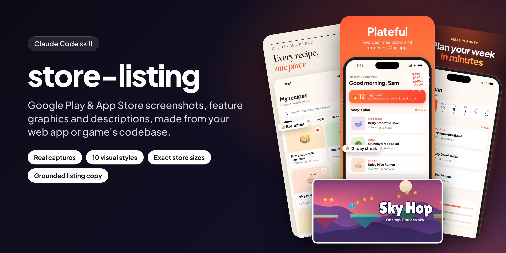
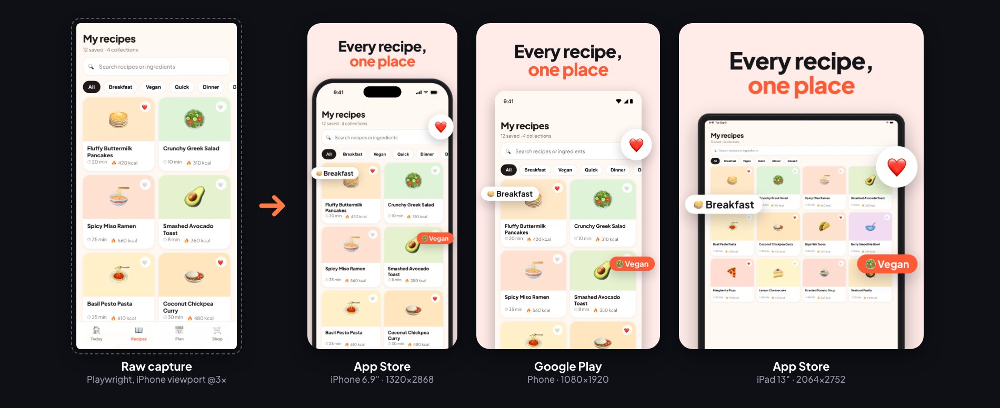
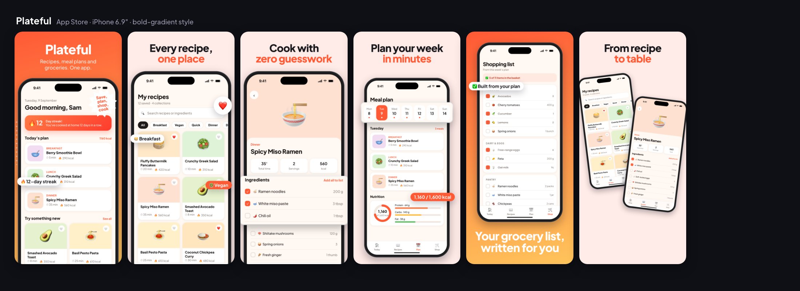
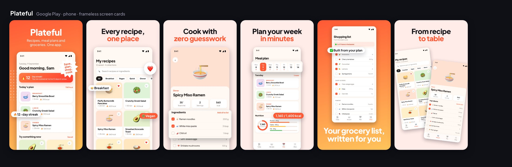
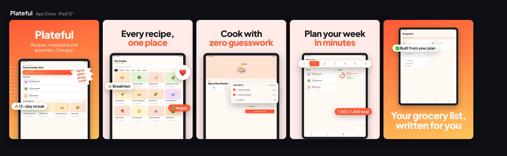
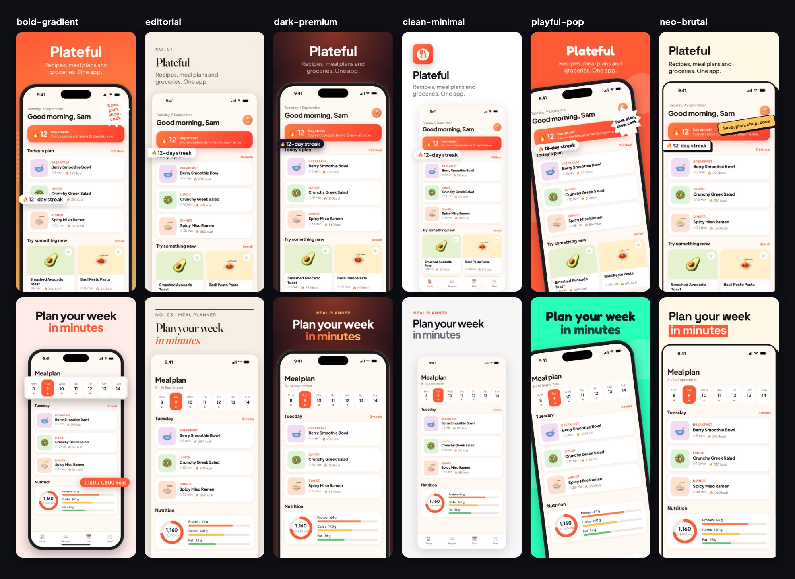
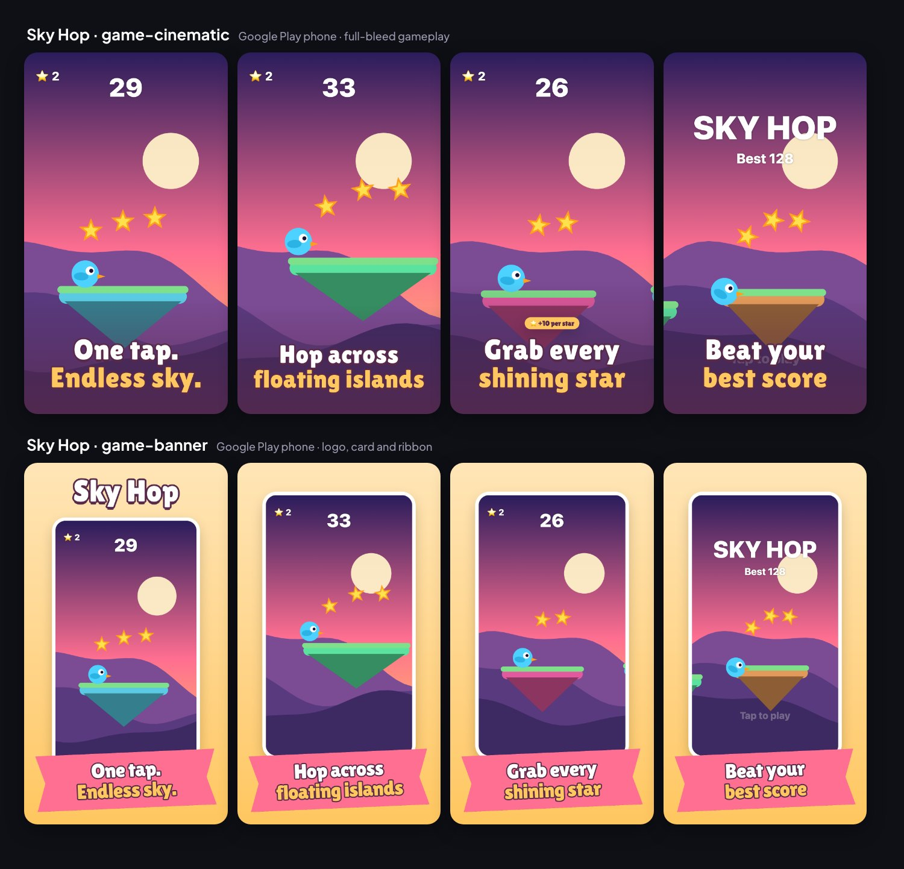
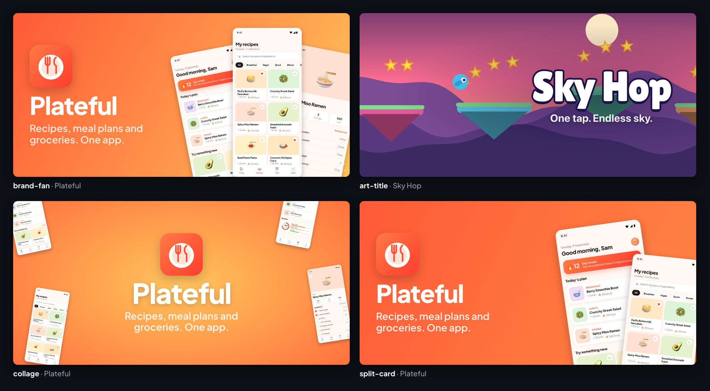
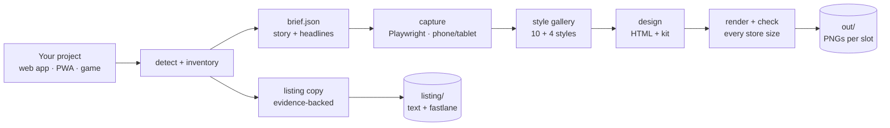

<p align="center">
  
</p>

<p align="center">
  <b>A <a href="https://docs.claude.com/en/docs/claude-code/skills">Claude Code skill</a> that turns a web app or HTML5 game's codebase into a complete Google Play and App Store listing.</b><br>
  Real screenshots · 10 visual styles · exact store sizes · feature graphic · descriptions grounded in your code
</p>

<p align="center">
  
  
  
  
</p>

<p align="center">
  <a href="#showcase">Showcase</a> ·
  <a href="#install">Install</a> ·
  <a href="#use-it">Use it</a> ·
  <a href="#styles">Styles</a> ·
  <a href="#listing-text">Listing text</a> ·
  <a href="#how-it-works">How it works</a> ·
  <a href="#reference">Reference</a> ·
  <a href="#faq">FAQ</a>
</p>

---

You built your app with web tech and wrapped it with **Capacitor, Cordova, Ionic, a TWA/PWA, a
WebView or Expo web**. Now the stores want a dozen screenshots in exact sizes, a 1024×500
feature graphic, a short description, a full description, a subtitle and keywords. All of it
has to look good, follow store policy and describe the app truthfully.

Ask Claude for it in your project, and **store-listing** does the whole job:

- **Runs your app** and captures the real screens with Playwright on iPhone-, Android- and
  iPad-sized viewports. No mockups, no AI-generated UI.
- **Shows a style gallery** of 10 screenshot styles and 4 feature-graphic styles, built from
  *your* screens and headlines, so you pick a look in one glance.
- **Renders every store size from one design**, with device frames, clean status bars, chips,
  stickers and zoomed callouts. It checks sizes, alpha, counts, cut-off text, overlapping
  decorations and Google's 20% text rule.
- **Writes the listing text** from a feature inventory of your code, with evidence for every
  claim. It's checked against character limits and store policy, and exported in fastlane
  format.

## Showcase

Everything below was generated by the skill from the two sample projects in
[`examples/`](examples). Every screen is a real capture of the running app.

### One capture, every store size



### A complete set



<details>
<summary><b>Same set for Google Play and iPad</b>: frameless cards on Play (Google advises against device imagery), iPad frames and layouts on the App Store</summary>
<br>




</details>

### Same screens, six styles



### Games

Full-bleed gameplay with captions kept clear of the HUD, or a logo, card and ribbon look.
Google Play gets native 9:16 captures, so nothing is cropped.



### Feature graphics



### Descriptions

Written from what the code actually does, with an evidence list behind every claim
([full example](examples/plateful/store-assets/listing/en-US.md)):

```text
Google Play · App name           Plateful: Recipes & Meal Plan
Google Play · Short description  Plan your week's meals and get a shopping list sorted by aisle, in one place.
App Store · Subtitle             Recipes, plans & groceries
App Store · Keywords             cooking,dinner,food,grocery,shopping,list,nutrition,calorie,healthy,vegan,menu,kitchen,diet

Evidence
- Weekly meal plan, week strip, meals per day with time + kcal: app.js plan(), route #/plan
- Shopping list grouped Produce/Dairy & eggs/Pantry, check-off with progress: app.js shop()
- NOT claimed: adding/importing recipes, search (the search bar is not functional), accounts, sync
```

```text
$ node store-listing/scripts/listing.mjs check examples/plateful/store-assets/listing
  Google Play · App name             29/30 chars full
  Google Play · Short description    77/80 chars full
  Google Play · Full description   1193/4000 chars
  App Store · Subtitle               26/30 chars
  App Store · Keywords               91/100 bytes full
  ✓ no problems found
```

## Install

You need **Node.js 18+** (20 or 22 LTS recommended) and **Claude Code**. ffmpeg is optional
and only needed for screen recordings and App Store preview videos.

```bash
git clone https://github.com/hisyam44/store-listing-skill.git
cd store-listing-skill
./install.sh
```

The installer runs `npm install` in `store-listing/` (which downloads Playwright's Chromium),
symlinks the skill into `~/.claude/skills/store-listing` and runs a system check. Restart
Claude Code afterwards. To install it for one project only, use
`./install.sh path/to/project`, which links into `path/to/project/.claude/skills/`. Because
the skill is a symlink, `git pull` updates it.

## Use it

Open Claude Code in a project that ships (or will ship) to the stores and ask in plain words:

> "Make the Google Play and App Store listing for this app"
>
> "Show me a few style options for the store screenshots first"
>
> "Create the feature graphic and 6 phone screenshots in the editorial style"
>
> "Write the Play Store short and full description, and the App Store subtitle and keywords"
>
> "Redo the screenshots and descriptions in German"

What happens next:

1. Claude reads the project: framework, dev command, brand colours and fonts, the native
   wrapper (app id, iPad support from the Xcode project), and a **feature inventory** of what
   the app can do.
2. It proposes a **brief**: which store slots, which screens in which order, and a benefit
   headline for each. You can adjust it, or say "just do it".
3. It starts your dev server, captures the screens with realistic seeded data, and checks
   every capture.
4. It shows you the **style gallery** and recommends one style.
5. It designs, renders and checks every size, iterating until the contact sheets look right.
6. It writes the **listing text** with its evidence and character counts.

Everything lands in `store-assets/` inside your project: inputs (brief, shot plan, captures,
designs, listing) and outputs (`out/`). Every stage can be re-run on its own, so the next app
update takes minutes.

## Styles

| Style | Look | Best for |
|---|---|---|
| `bold-gradient` | brand-gradient hero, soft benefit slides, devices bleeding off the edge, chips, sticker | lifestyle, food, habits, social, shopping |
| `clean-minimal` | near-white, left-aligned quiet type, frameless screens, lots of air | finance, productivity, utilities, health data, B2B |
| `dark-premium` | deep navy with a brand glow, gradient accent words | pro tools, AI, finance, fitness, music, photo and video |
| `editorial` | paper background, serif headline, italic accent, numbered sections | reading, journaling, recipes, travel, wellness |
| `playful-pop` | a bright colour per slide, rounded type, tilted devices | kids, education, social, casual games, pets |
| `neo-brutal` | cream, heavy grotesk, black outlines, hard shadows | productivity, dev and creator tools, Gen-Z social |
| `big-number` | a real figure from the app leads each image | finance, health, fitness, analytics |
| `panoramic` | one background runs across the whole set | journeys and flows; stands out (few listings use it) |
| `game-cinematic` | full-bleed gameplay, outlined captions | immersive games |
| `game-banner` | logo, gameplay card, ribbon caption | casual, puzzle, idle, kids' games |

Feature graphics: `brand-fan`, `art-title`, `collage`, `split-card`.

The styles follow published ASO practice: benefit-led captions under about 5 words, a story
across the set, clarity first for trust categories, gameplay first for games, and Google's
no-device-imagery advice. Each style is plain HTML/CSS, so you can tweak it, mix styles per
slide or add your own. See [`references/styles.md`](store-listing/references/styles.md).

## Listing text

| Store | Field | Limit |
|---|---|---|
| Google Play | App name / Short description / Full description | 30 / 80 / 4,000 chars |
| App Store | Name / Subtitle / Promotional text / Description | 30 / 30 / 170 / 4,000 chars |
| App Store | Keywords | 100 bytes |

`inventory.mjs` finds what the app can do, each item with file:line evidence: native plugins,
libraries, code patterns, ads and in-app purchases, permissions, locales, and the app's own UI
vocabulary. Claude writes `listing/<locale>.md` from it and states only what's confirmed.
`listing.mjs check` then flags:
- limits and placeholders
- emoji or ALL CAPS in names
- "#1", "best", "free", "sale" claims
- mentions of the other platform
- keyword stuffing and keyword lists
- anonymous testimonials
- App Store keyword hygiene (spaces, duplicates, words already in the name)
- missing in-app-purchase disclosure

`listing.mjs export` writes fastlane's `metadata/` layout. Details:
[`references/listing.md`](store-listing/references/listing.md).

## How it works



- **Designs are HTML.** Each screenshot is a `<section>` styled by a small kit where
  `1rem` = 1% of the image's short side. The same design renders at 1320×2868, 1206×2622,
  1080×1920, 2064×2752 or 1024×500 and reflows for each. The kit draws iPhone, Android, iPad and
  browser frames with a clean 9:41 status bar tinted to your app's header. It also handles
  callouts (zoomed crops of your UI), chips, stickers, stats and panoramic backgrounds, and
  nudges decorations back inside each shape.
- **Rendering is deterministic.** Headless Chromium screenshots each slide at the target's
  exact pixel size as flattened RGB PNG, so no alpha. The kit reports layout problems per slide
  and target, and contact sheets make review quick.
- **Nothing is generated by an image model.** The screens are your app, so they're accurate,
  sharp and allowed: Apple guideline 2.3.3 says screenshots must show the app in use.

## Reference

<details>
<summary><b>What it produces</b></summary>

| Store | Slot | Size | Notes |
|---|---|---|---|
| App Store | iPhone 6.9″ (Dynamic Island, large) | 1320×2868 | largest iPhone size |
| App Store | iPhone 6.3″ (Dynamic Island, medium) | 1206×2622 | required for iPhone apps |
| App Store | iPad 13″ | 2064×2752 | required if the app runs on iPad |
| Google Play | Phone | 1080×1920 | 2–8 images, 4+ recommended |
| Google Play | 7″ and 10″ tablets | 1440×2560 | 4–8 images |
| Google Play | Chromebook | 1920×1080 | on request |
| Google Play | Feature graphic | 1024×500 | required |
| Both | Landscape variant of every screenshot slot | swapped | |
| Both | Icons | 1024 (App Store) / 512 (Play) | `render.mjs icon` |
| App Store | App preview video | 886×1920 / 1200×1600, 15–30 s | from a screen recording, `ff.sh preview` |
| Both | Listing text per locale | | `listing/<locale>.md` + fastlane export |

Specs were checked against Apple's and Google's documentation in October 2026; see
[`references/store-specs.md`](store-listing/references/store-specs.md).
</details>

<details>
<summary><b>Scripts</b> (Claude runs these for you; you can run them too)</summary>

| Script | Does |
|---|---|
| `doctor.mjs` | checks Node, Playwright, Chromium and ffmpeg |
| `detect_project.mjs` | framework, dev command, routes, brand, native wrapper, iPad support |
| `inventory.mjs` | features, monetization, permissions, locales and UI vocabulary, with evidence |
| `run_app.mjs start\|stop` | runs the dev server in the background |
| `capture.mjs --probe / --plan` | finds selectors and crop values; captures stills, bursts and recordings per device |
| `scaffold.mjs --init / --style` | writes the brief; writes the design in a style |
| `gallery.mjs` | renders every style with your content, for choosing |
| `render.mjs [serve\|icon\|check\|targets]` | renders and checks every target; live preview; icons |
| `listing.mjs init\|check\|export` | listing text template, policy checks, fastlane export |
| `ff.sh` | frames, stills from recordings, App Store app previews |
</details>

<details>
<summary><b>Files in your project</b></summary>

```
store-assets/
  inventory.json      what the app does, with evidence
  brief.json          name, tagline, colours, style, one entry per screenshot
  shots.json          capture plan
  captures/           raw screens per device + manifest.json
  design/             screenshots.html, feature.html (+ kit/, assets/)
  out/                upload-ready images, _preview/ contact sheets, report.json
  listing/            <locale>.md listing text, metadata/ (fastlane layout)
```
Commit the inputs (brief, shot plan, captures, designs, listing). Ignore `.run/`,
`out/_preview/` and `out/_gallery/`.
</details>

<details>
<summary><b>Docs</b> (what Claude reads while working)</summary>

- [`SKILL.md`](store-listing/SKILL.md): the workflow
- [`references/store-specs.md`](store-listing/references/store-specs.md): sizes, counts and content rules for both stores
- [`references/capture.md`](store-listing/references/capture.md): shot plans, devices, seeding data, games, recordings
- [`references/styles.md`](store-listing/references/styles.md): the styles, the research behind them, choosing one
- [`references/design.md`](store-listing/references/design.md): the design kit (layouts, frames, decorations, callouts, checks)
- [`references/listing.md`](store-listing/references/listing.md): writing grounded listing text
</details>

## Examples

| | Plateful | Sky Hop |
|---|---|---|
| What | recipe and meal-planner PWA with a Capacitor config | one-tap canvas game |
| Style | `bold-gradient`, hand-polished | `game-cinematic` + `art-title` feature graphic |
| Inputs | [brief](examples/plateful/store-assets/brief.json) · [shots](examples/plateful/store-assets/shots.json) · [design](examples/plateful/store-assets/design/screenshots.html) · [listing](examples/plateful/store-assets/listing/en-US.md) | [brief](examples/sky-hop/store-assets/brief.json) · [shots](examples/sky-hop/store-assets/shots.json) · [design](examples/sky-hop/store-assets/design/screenshots.html) · [listing](examples/sky-hop/store-assets/listing/en-US.md) |

Regenerate an example's images (rendered output isn't committed):

```bash
cd examples/plateful
node ../../store-listing/scripts/scaffold.mjs .    # copies the kit into design/kit/ (existing designs are kept)
node ../../store-listing/scripts/render.mjs        # → store-assets/out/
node ../../store-listing/scripts/gallery.mjs .     # → store-assets/out/_gallery/
```

## FAQ

**Does it work with native apps (Swift, Kotlin, Flutter, React Native)?**
The capture step drives a browser, so it's built for web-based apps. Everything else works
with your own screenshots: put PNGs in `store-assets/captures/phone/<name>.png` (and
`tablet/`), and the gallery, designs, rendering and listing text work as usual.

**Is anything AI-generated?** The images are your real UI, laid out with HTML/CSS. Claude
writes the headlines and descriptions from the code and checks every claim against an
evidence list. You review both before uploading.

**Will the stores accept the files?** Sizes, formats, alpha, counts and text limits are
checked against the current specs, and policy-style problems are flagged. Whether the
*content* is accurate is still your call: the skill makes that easy to verify, not optional.

**Can I use my own design?** Yes. The designs are plain HTML files you can edit freely; the kit
handles sizing, frames and checks. You can also add a style to `kit/styles.css` and
`scripts/lib/styles.mjs`, and it shows up in the gallery.

**Fonts look wrong or missing.** Fonts load from Google Fonts at render time, so it needs network
access; offline renders fall back to the system font.

**The captures show the wrong app.** Something else was already serving the dev port. Stop
it, or start the app on another port.

## Related

- [promo-video-skill](https://github.com/hisyam44/promo-video-skill): the companion skill that
  turns the same codebase into a promo video or App Store trailer.

## Contributing

Issues and pull requests are welcome, especially new styles, store-spec updates and fixes from
real projects. See [CONTRIBUTING.md](CONTRIBUTING.md).

## License

[MIT](LICENSE). App Store and Google Play are trademarks of Apple Inc. and Google LLC. This
project isn't affiliated with either.
